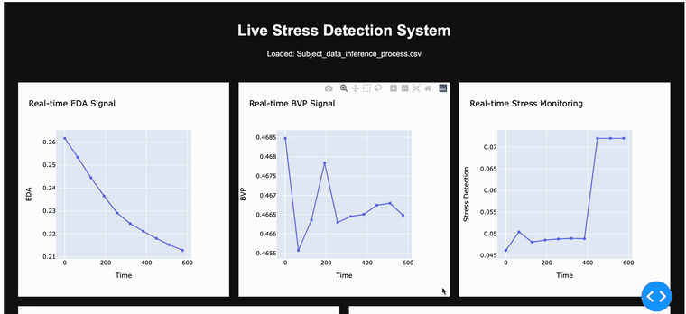
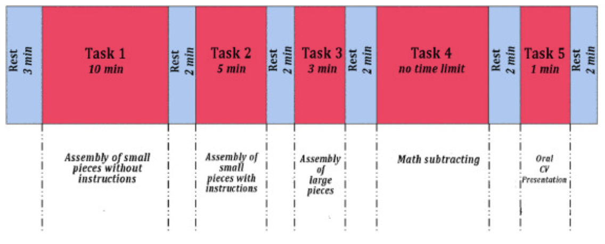
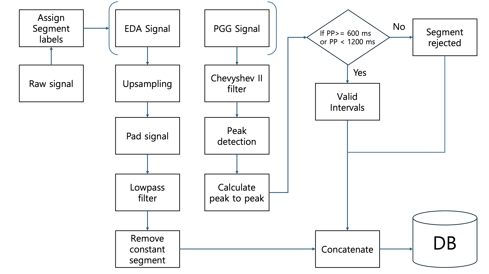
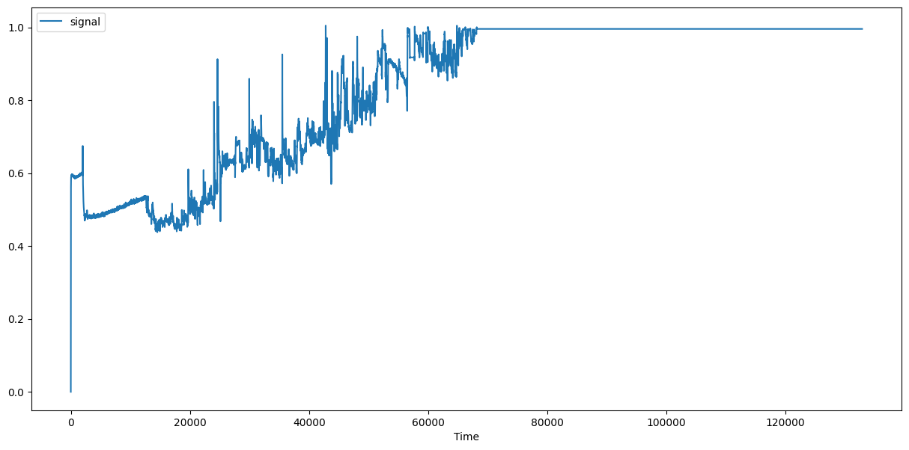
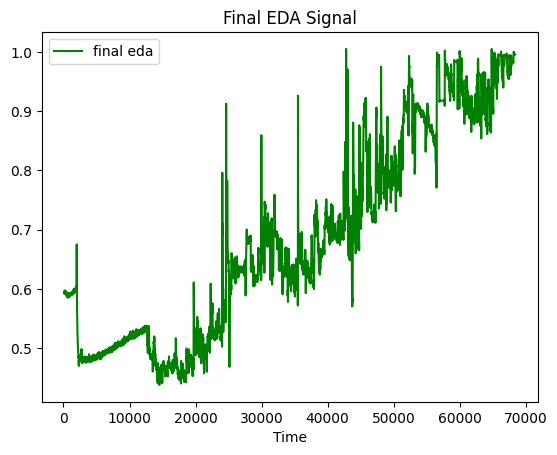
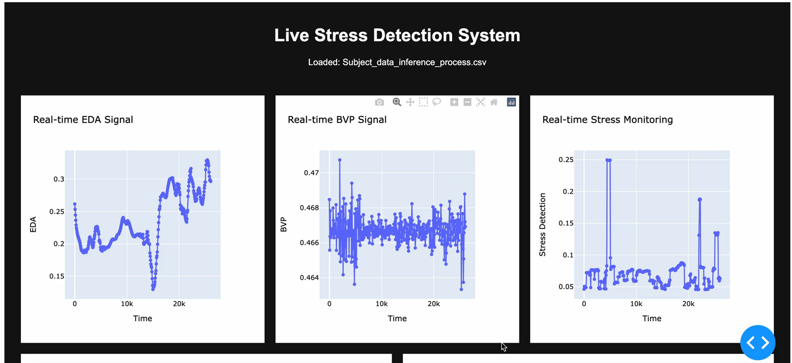

# StressAI — Real-Time Stress Detection from Wearable Biosignals

Binary stress/rest classification from two wrist-worn signals — electrodermal
activity (EDA) and blood volume pulse (BVP) — served as a live API with a
streaming dashboard.

The point of the project is not the classifier. It is the path from **raw
wearable CSV → cleaned, aligned, labelled signal → database → trained model →
running service**, with the signal-processing stage carrying most of the weight.

The target is deliberately narrow: not a general stress classifier, but a
**real-time detector of contextual anomalies** — a sharp change against this
person's own recent baseline. That reframing is what makes the sliding-window
and per-subject scaling choices below the right ones.



*The dashboard replaying a recording: EDA and BVP stream in while the stress
prediction updates alongside. Full clip:
[`docs/media/dashboard-demo.mp4`](docs/media/dashboard-demo.mp4).*

---

## Table of contents

- [Pipeline](#pipeline)
- [Signal processing](#signal-processing)
- [Models](#models)
- [Results](#results)
- [Data](#data)
- [Setup](#setup)
- [Usage](#usage)
- [Repository layout](#repository-layout)
- [Limitations](#limitations)

---

## Pipeline

```
Empatica E4 CSVs            stress_data.py
EDA  @  4 Hz  ─┐        ┌─ interpolate missing values
BVP  @ 64 Hz  ─┼───────►│─ upsample EDA 4 → 64 Hz, pad to BVP length
ACC/HR/IBI/TEMP┘        │─ low-pass filter (Chebyshev II / Butterworth)
                        │─ drop constant (sensor-dropout) segments
                        └─ label from the Rest/Task protocol
                                    │
                                    ▼
                           stress_db.py  →  MySQL
                      (subjects, eda_data, bvp_data, label_data)
                                    │
                                    ▼
                             train.py  →  fine_tuned_model.pt
                       sliding window 320 samples (5 s @ 64 Hz)
                                    │
                        ┌───────────┴───────────┐
                        ▼                       ▼
                 app/app.py (FastAPI)     dashboard.py (Dash)
                 POST /upload_and_predict  live replay + plots
```

## Signal processing

The two sensors do not agree on anything, which is most of the work.

**Different sampling rates.** EDA arrives at 4 Hz, BVP at 64 Hz. EDA is upsampled
to 64 Hz and padded to the BVP length so the two can be stacked into one
`(timesteps, 2)` tensor. Upsampling the slow signal is preferred to decimating
the fast one — BVP's waveform shape is the informative part and downsampling
destroys it.

**Missing values and dropouts.** Gaps are interpolated per channel. Separately,
long runs of a constant value mark sensor dropout rather than a real flat
signal, and those segments are removed (`remove_constant_segments`, threshold
1e-10) instead of being fed to the model as genuine readings.

**Filtering.** Low-pass filtering (Chebyshev II / Butterworth, zero-phase via
`filtfilt`) removes high-frequency noise. Zero-phase matters here: a causal
filter shifts the signal in time, and a time-shifted signal against fixed
protocol labels means every window is slightly mislabelled.

**Labelling.** The recording protocol alternates rest and task blocks, each task
a different stressor — timed assembly with and without instructions, mental
arithmetic, and an oral CV presentation:



In minutes:

| Block | Rest 1 | Task 1 | Rest 2 | Task 2 | Rest 3 | Task 3 | Rest 4 | Task 4 | Rest 5 | Task 5 | Rest 6 |
| --- | --- | --- | --- | --- | --- | --- | --- | --- | --- | --- | --- |
| Minutes | 3 | 10 | 2 | 5 | 2 | 3 | 2 | — | 2 | 1 | 2 |

Samples are labelled by which block they fall in — `Rest → 0`, `Task → 1` —
converting minutes to sample counts at each channel's own rate.

### The full preprocessing flow



The two channels take different routes. EDA is upsampled, padded, low-pass
filtered and stripped of constant segments. PPG is Chebyshev II filtered, then
peak-detected, and the **peak-to-peak interval is validated against a
600–1200 ms window** — intervals outside that range are not plausible heart
beats, so those segments are rejected rather than cleaned. What survives both
branches is concatenated and written to the database.

### Sensor dropout, before and after

| Raw EDA | After `remove_constant_segments` |
| --- | --- |
|  |  |

The flat line from ~68,000 samples onward is not a calm participant — it is the
sensor stuck at a constant value. Left in, the model would learn that a
perfectly steady signal means "rest". Roughly half the recording is discarded
here, which is the right trade.

### Windowing and scaling

A plain train/validation split is wrong for a real-time detector, so the signal
is cut into **sliding windows of 64 × 5 = 320 samples** — five seconds at 64 Hz
— each window carrying a continuous stretch of behaviour rather than an isolated
reading.

**Min-max scaling is applied to normalise between participants.** Baseline skin
conductance differs enormously from person to person; without rescaling, the
model learns who someone is rather than whether they are stressed.

## Models

Both live in [`model.py`](model.py) and share the same input shape,
`(batch, 320, 2)`:

**`StressRNN`** — single-layer LSTM (hidden 64), last hidden state into a linear
head. The straightforward baseline for a time series.

**`StressTransformer`** — linear embedding to 128 dims, 2 `TransformerEncoder`
layers with 4 attention heads, mean-pooled over time, linear head. This is what
is actually served, chosen over the LSTM for its handling of long-range
dependence across the window.

Training ([`train.py`](train.py)) runs **per subject, sequentially**, each
subject's model initialised from the previous subject's weights — a fine-tune
chain across 29 participants rather than one pooled fit. `CrossEntropyLoss`,
Adam, 10 epochs per subject.

Hyperparameters after tuning:

| Parameter | Initial | Final |
| --- | --- | --- |
| Batch size | 32 | **64** |
| Hidden dim | 64 | **256** |
| Embedding dim | 64 | **128** |
| Attention heads | 8 | **4** |

No learning-rate scheduler — worth adding if convergence degrades late in
training, but it was not needed at this scale.

## Data

Recordings come from an **Empatica E4** wristband — ACC, BVP, EDA, HR, IBI and
TEMP for 29 participants.

> **The biosignal recordings are not included in this repository.** They are
> physiological measurements from human participants, so they are not
> redistributed here. The code expects them under `data/` — see
> [`data/README.md`](data/README.md) for the directory layout and file formats
> the loader assumes.

`fine_tuned_model.pt` (the trained `StressTransformer` weights) **is** included,
so the API and dashboard can be run without the raw recordings.

## Setup

```bash
git clone https://github.com/paulms77/StressAI.git
cd StressAI

python -m venv .venv && source .venv/bin/activate
pip install -r requirements.txt
```

MySQL is only needed for the training path:

```sql
CREATE DATABASE stress_db CHARACTER SET utf8mb4;
USE stress_db;

CREATE TABLE subjects (
  id INT AUTO_INCREMENT PRIMARY KEY,
  subject_name VARCHAR(32) UNIQUE
);
CREATE TABLE eda_data   (id INT AUTO_INCREMENT PRIMARY KEY, subject_id INT, eda    DOUBLE);
CREATE TABLE bvp_data   (id INT AUTO_INCREMENT PRIMARY KEY, subject_id INT, bvp    DOUBLE);
CREATE TABLE label_data (id INT AUTO_INCREMENT PRIMARY KEY, subject_id INT, labels INT);
```

Configuration is read from the environment:

| Variable | Default | Used by |
| --- | --- | --- |
| `STRESS_MODEL_PATH` | `fine_tuned_model.pt` | API, dashboard |
| `STRESS_RAW_DIR` | `data/Subjects` | preprocessing |
| `STRESS_DATA_DIR` | `data/Subjects_processing` | preprocessing, DB load |
| `DB_HOST` / `DB_PORT` | `127.0.0.1` / `3306` | DB load, training |
| `DB_USER` / `DB_PASSWORD` | `root` / *(empty)* | DB load, training |
| `DB_NAME` | `stress_db` | DB load, training |

## Usage

### Serve the API

```bash
python main.py          # uvicorn on 0.0.0.0:9999, auto-reload
```

```bash
curl -X POST http://localhost:9999/upload_and_predict \
     -F "file=@data/Subjects_processing/subject_02/Subject_data.csv"
```

The uploaded CSV needs `eda` and `bvp` columns. It is cut into 320-sample
(5 second) windows and each window is classified. Interactive docs are at
`http://localhost:9999/docs`.

### Live dashboard

```bash
python dashboard.py     # Dash on http://localhost:8050
```

Replays a recording one second at a time (`dcc.Interval`), plotting EDA and BVP
alongside the rolling stress prediction, plus model accuracy and loss.



**Why Dash is the primary surface, not FastAPI.** Both exist in this repository,
but the dashboard is the one that matters. FastAPI is the better fit for
request/response inference; it gives you nothing for *watching* a signal. This
project is about noticing a stress spike as it happens, which is a visualisation
problem — and Dash builds the whole interactive front end from Python alone, with
no separate frontend to write. On a three-week build, that decided it.

### Reproduce from raw recordings

```bash
export STRESS_RAW_DIR=data/Subjects
export STRESS_DATA_DIR=data/Subjects_processing

python stress_data.py   # 1. clean, align, label  → per-subject CSVs
python stress_db.py     # 2. load CSVs into MySQL
python train.py         # 3. train → fine_tuned_model.pt
```

## Repository layout

```
model.py            StressRNN (LSTM) and StressTransformer definitions
stress_data.py      signal processing — interpolation, resampling, filtering,
                    dropout removal, protocol-based labelling
stress_db.py        load per-subject CSVs into MySQL
train.py            sequential per-subject training loop
process.py          small helper for preparing a single subject for inference
main.py             uvicorn entry point
app/app.py          FastAPI service — POST /upload_and_predict
dashboard.py        Dash dashboard — live replay and prediction plots
fine_tuned_model.pt trained StressTransformer weights
data/               expected location of recordings (not included)
```

## Results

**~70% accuracy** under the constraints described above — a single wristband,
29 participants, and training on a free-tier T4.

That is enough to flag the sharp, obvious stress transitions and not much more.
The honest reading is that it detects large changes reliably and subtle ones
poorly, which is consistent with what two channels from a consumer wristband can
carry.

What would move it: a wider age range in the participant pool, a revised
protocol designed to reduce the ambiguous middle ground (see
[Limitations](#limitations)), and more compute than a free T4 allows. The
intended direction is to use the class probability as a graded stress *level*
rather than a binary flag, and attach guidance to each level.

## Limitations

**Binary labels come from the protocol, not from the participant.** A sample is
labelled "stress" because it fell inside a task block, not because that person
was measurably stressed at that moment. Someone relaxed during a task is
mislabelled, and there is no way to detect that from the signal alone.

**Sequential per-subject fine-tuning is not the same as training on everyone.**
Each subject's model starts from the previous subject's weights, so later
subjects carry more influence and the final weights are biased toward the end of
the sequence. A pooled fit with subject-wise cross-validation would be the
sounder comparison.

**The reported accuracy is not leave-one-subject-out.** Within-subject windows
are heavily correlated, so any split that is not subject-wise leaks. The ~70%
figure should be read as indicative, not as generalisation to an unseen person.

## License

MIT — see [LICENSE](LICENSE).
